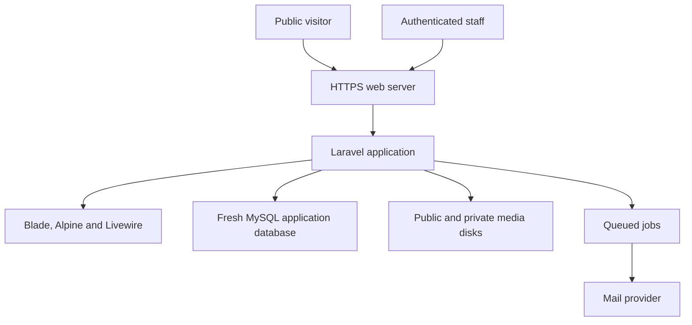

# MAA Website Rebuild — Technical Architecture

Prepared: 14 November 2026  
Companion document: [roadmap.md](roadmap.md)  
Status: Fresh-build architecture. No implementation or database connectivity has been performed.

Scope decision: Build a new application and schema from scratch. No existing-site backup, WordPress data import, shared-database coexistence or legacy connection is required. Use the current site only as a reference for approved text, logo and original photographs.

## 1. Architecture decisions

Build a modular Laravel monolith: one application for the public website, staff CMS, forms and content management. A separate API, React application, microservices and public user accounts are unnecessary for the first release.

| Layer | Decision | Purpose |
| --- | --- | --- |
| Framework | Laravel 12, PHP 8.2 compatible | Requested backend baseline |
| Database | Fresh dedicated MySQL database | `maausa` if unused, otherwise `maausa_new`; independent environments |
| Public rendering | Blade | Indexable pages and low JavaScript overhead |
| Styling | Tailwind CSS plus CSS design tokens | Consistent responsive spacing and components |
| Browser interactions | Alpine.js | Menus, accordions, dialogs and header state |
| Server-driven UI | Selective Livewire | Filters, registration and CMS interactions |
| Admin | Custom Blade/Livewire CMS | Direct control over workflows and UI |
| Icons | Locally bundled Material Symbols/SVG subset | Consistent Material-inspired icons |
| Assets | Vite with locked dependencies | Compiled CSS/JS and versioned assets |
| Media | Public approved media; separate private storage | Keep inquiries and operational files out of public uploads |
| Async work | Laravel queues and scheduler | Mail, derivatives, housekeeping and operational tasks |

Material UI here describes the visual language; do not install React MUI in this Blade application. Select maintained package versions that resolve against the project's runtime and commit composer.lock/package-lock.json. Exact Livewire, Tailwind and Node versions must be resolved and tested at kickoff rather than assumed.

### Runtime support

Laravel 11 is excluded: its security support ended on 12 March 2026. Laravel 12 supports PHP 8.2 but security support ends on 24 February 2027. PHP 8.2 security support ends on 31 December 2026. Keep code PHP 8.2-compatible initially, but plan production PHP 8.4 and a supported framework upgrade before those deadlines. Laravel 13 requires PHP 8.3+. Runtime upgrades include dependency resolution, automated tests and staging rehearsal.

## 2. System topology



Public requests read published records from the new Laravel database. Staff create content through the new CMS. Visitors reach the donation provider through a verified hosted checkout link.

## 3. Fresh database setup

Create a new empty MySQL database exclusively for this application. Use `maausa` if the name is unused on that server; otherwise use `maausa_new`. Do not clear, reuse or overwrite a populated database. Local, staging and production each have separate databases and credentials. No WordPress database access or export is needed.

Use Laravel's standard `mysql` connection and conventional unprefixed tables such as `users`, `pages` and `events`. No `legacy` connection, `LEGACY_*` environment variables or `DB_PREFIX` customization is required. Use utf8mb4 and a collation supported by the selected MySQL version. Validate that version against Laravel's supported database requirements.

Example environment template — placeholders only:

```dotenv
APP_NAME="MAA"
APP_ENV=local
APP_DEBUG=true
APP_URL=http://localhost

DB_CONNECTION=mysql
DB_HOST=127.0.0.1
DB_PORT=3306
DB_DATABASE=maausa_new
DB_USERNAME=maa_app
DB_PASSWORD=SET_OUTSIDE_SOURCE_CONTROL

QUEUE_CONNECTION=database
SESSION_DRIVER=database
CACHE_STORE=database
```

Generate APP_KEY per environment and preserve the production key across releases. Keep credentials outside Git. Production uses `APP_DEBUG=false`, HTTPS and secure cookies. Use least-privilege runtime credentials and a separate deployment account for schema changes where practical.

Create tables with Laravel migrations and use factories/seeders for local development. Keep demo data out of production. `migrate:fresh` is only for an explicitly disposable local/test database; it is not a deployment command. Production deployments use reviewed incremental migrations against the new application database.

The initial database setup requires no old-site backup. Routine recovery protection for new application content and submissions is a separate production operation.

## 4. Proposed data model

Use the unprefixed table names below in the new database. Include primary keys, appropriate timestamps and foreign-key indexes. All tables are created from fresh Laravel migrations.

| Table | Core fields and rules |
| --- | --- |
| users | name, unique email, password hash, role, is_active; staff only |
| pages | unique slug, title, structured body, draft/published status, published_at, SEO fields, author_id |
| page_sections | page_id, type, validated JSON content, sort_order, is_enabled; composite ordering index |
| programs | unique slug, title, summary, body, image_id, status, sort_order, SEO fields |
| resources | unique slug, title, summary, body, format, language, video_url/file_id, status, published_at, SEO fields |
| categories | name, unique slug; resource topics |
| category_resource | resource_id, category_id; unique pair |
| events | unique slug, title, body, starts_at/ends_at UTC, timezone, venue, online_url, capacity nullable, registration_enabled, status, image_id |
| event_registrations | event_id, normalized email, name, attendee_count, status, confirmation token hash, consent_at; unique event/email |
| inquiries | type, name, contact details, preferred contact/language, message, status, assigned_to, consent_at, handled_at |
| albums | title, unique slug, description, status, cover_media_id |
| album_media | album_id, media_id, caption, sort_order; unique pair |
| media | disk, unique path per disk, mime, size, dimensions, alt_text, focal point, credit, consent reference |
| team_members | name, role/title, bio, photo_id, sort_order, is_published |
| settings | unique key, validated JSON value; no database/payment/mail secrets |
| audit_logs | actor_id, action, entity type/id, timestamp, redacted change summary |
| framework tables | migrations, sessions, cache/cache_locks, jobs/job_batches/failed_jobs, password_reset_tokens as configured |

Relationships: pages have ordered sections; resources belong to multiple categories; events have registrations; albums contain ordered media; content can reference media; users author content and handle inquiries. Use foreign keys between application tables. There are no legacy IDs or WordPress relationships.

Use explicit status enums in PHP with validated database strings. Index published listings by status/published_at, events by status/starts_at, and inquiries by status/created_at. Paginate collections and eager-load relationships. Do not collect diagnosis, medical records or child documents in the initial support form.

## 5. Request boundaries and code organization

| Path | Responsibility |
| --- | --- |
| app/Http/Controllers/Public | Public page queries and rendering |
| app/Http/Controllers/Admin | Staff CRUD and operational screens |
| app/Http/Requests | Validation and authorization for HTTP form requests |
| app/Livewire/Public | ResourceFilters, EventRegistration, optional SupportRequest |
| app/Livewire/Admin | Content editor helpers, media selector and operational tables |
| app/Actions | SubmitInquiry, RegisterForEvent, PublishContent |
| app/Models | Eloquent entities and publication scopes |
| app/Policies | Per-record staff authorization |
| app/Jobs and app/Notifications | Queued mail and media processing |
| app/Console/Commands | Administrator provisioning and operational commands |
| resources/views/layouts | Public and admin layout shells |
| resources/views/components | Buttons, forms, navigation, icons and reusable surfaces |
| resources/views/pages | Page-specific editorial layouts |
| resources/css and resources/js | Design tokens, Tailwind entry and Alpine initialization |
| database/migrations | Reviewed new-table and additive changes |
| tests/Feature and tests/Unit | Workflow, authorization and domain tests |

Controllers/components validate and authorize, then call shared actions. Keep business rules out of Blade templates. A public Livewire component is not an authorization boundary: validate every submitted field and re-query server-authoritative records.

## 6. Frontend responsibility map

| Feature | Implementation |
| --- | --- |
| Header/footer, hero, page content, SEO metadata | Blade |
| Transparent-to-solid sticky header | Alpine, based on scroll/intersection state |
| Mobile navigation, program accordion, gallery dialog | Alpine with keyboard/focus management |
| Resource search and filters | Livewire island; URL query state and debounced input |
| Event registration | Livewire island calling transactional registration action |
| Contact and simple support forms | Blade POST by default; Livewire only when progressive state improves usability |
| Admin dependent fields, searchable tables and media selection | Selective Livewire |
| Ordinary site navigation | Standard links and server rendering |

Ensure only one Alpine runtime is loaded. Livewire includes Alpine in its documented setup; use a shared, version-appropriate initialization strategy and do not also load Alpine from a CDN. Load Livewire assets only in layouts that need them where supported by the selected version; verify script behavior on mixed pages. Avoid polling and server requests for visual-only toggles.

## 7. Visual and responsive specification

The most recent spacious mockup is a visual reference. Reuse original MAA source photographs in implementation, not AI-regenerated crops extracted from the mockup. Store focal points so responsive crops preserve faces.

| Token | Desktop | Tablet | Mobile |
| --- | --- | --- | --- |
| Content width | max 1200px, centered | fluid | fluid |
| Outer gutter | 48–80px minimum where space permits | 32px | 20px |
| Main section padding | 96px top/bottom | 64px | 48px |
| Major column gap | 48px | 32px | 24px stacked |
| Heading-to-content gap | 40–48px | 32px | 24px |
| Surface internal padding | 32–40px | 28px | 24px |
| Body typography | 17–18px, 1.6 line height | 17px | 16px |
| Main heading | fluid 44–64px | fluid | 34–40px |
| Section heading | 36–44px | 32–36px | 28–32px |
| Interactive targets | minimum 44px intended target size | same | same |

Use Inter or a comparable licensed sans-serif; headings weight 500–600, body 400, restrained 700 for emphasis. Use consistent 8px spacing multiples, charcoal text, white/pearl surfaces and plum accents. Check final foreground/background contrast rather than assuming palette colors pass.

Homepage order:

1. Transparent header over photo hero, with readable gradient overlay and support actions.
2. Three-path support strip with modern icons.
3. Purpose statement and wide photo plus editorial panel.
4. Programs accordion with a distinct introduction column.
5. Asymmetric community imagery.
6. Featured resource and supporting links.
7. Spacious involvement/donation call to action.
8. Footer with contact and legal links.

On mobile, make the open menu an opaque readable surface, stack content, collapse gallery columns and preserve logical reading order. Provide visible focus, semantic headings, skip link, labeled fields, aria-expanded states, dialog focus return and reduced-motion support. Do not autoplay video or animate essential text.

## 8. Routes and content rules

| Route | Behavior |
| --- | --- |
| / | Published homepage sections |
| /about | Organization story and team |
| /programs and /programs/{slug} | Published services |
| /resources and /resources/{slug} | Filtered library and individual resource |
| /events and /events/{slug} | Upcoming/past events and details |
| /events/{slug}/register | Registration flow if enabled |
| /gallery and /gallery/{slug} | Published albums |
| /get-support | Support form |
| /get-involved | Volunteer/partnership introduction and inquiry |
| /donate | Donation explanation and verified external provider link |
| /contact | Contact details and form |
| /privacy and /accessibility | Reviewed policy content |
| /admin/* | Authenticated, role-authorized staff screens |

Define stable routes for the new website. A legacy redirect project is not required for this fresh build; add specific redirects later only if requested. Publication scopes apply to every public lookup. Draft previews require authorization and expiring signed links. Use stable slugs, canonical URLs, unique titles, social metadata and a published-only sitemap. Structured data must reflect actual page facts.

## 9. Core workflows

### Content publishing

Editor saves a draft → validation and HTML sanitization → authorized preview → authorized publish action → cache invalidation → public Blade rendering. Homepage section types are allowlisted and field-validated. Do not allow arbitrary script or template injection. Publishing permission can be restricted independently of editing.

### Support inquiry

Validate contact fields and topic → check CSRF and rate limit/honeypot → persist inquiry and consent timestamp → show confirmation → queue minimal acknowledgment and staff notification after commit. Notification failure must not lose the inquiry. Staff receive a record link rather than full sensitive messages in email. Staff status sequence: new → assigned → in_progress → resolved or archived.

### Event registration

Validate published/open event and attendee count → begin transaction → lock event row → check capacity against confirmed attendee totals → create registration → commit → queue confirmation. All registration and cancellation paths lock the same event row. A unique event/email key prevents duplicates; provide a resend/update route instead of duplicating. Closed/full events return an accessible message. Store UTC timestamps and an IANA timezone for display. Use an unguessable cancellation token stored as a hash. Calendar labels display the event timezone explicitly.

### Donations

Phase one opens the verified hosted donation page. Do not display payment success based on a return URL and do not store card details. If native donation tracking is added later, introduce signed webhooks, unique provider event IDs, idempotent processing, reconciliation and explicit paid/refunded states as a separate release.

## 10. Administration and authorization

| Role | Access |
| --- | --- |
| Administrator | Staff accounts, configuration, all content and operations |
| Content Editor | Draft/edit approved content, media and events; publish only if explicitly granted |
| Support Coordinator | Inquiries and event registrations; no account/system configuration |

Enforce permissions in controllers, policies and Livewire actions, not just menus. Use framework session authentication, login throttling and password reset. Public registration is disabled. Enable staff MFA through a compatible implementation where feasible. Audit publishing, deletions, role changes and record status changes without copying sensitive message bodies into logs.

## 11. Fresh content creation and initialization

1. Apply migrations to create the new schema.
2. Seed required settings and roles without demo content or hardcoded passwords.
3. Provision the initial administrator securely; no WordPress users/passwords are transferred.
4. Build frontend templates using clearly labeled development fixtures.
5. Enter approved page, program, resource and event content through the new CMS.
6. Upload selected original logo/photos, set alt text and focal points, and verify publication permission.
7. Review new SEO metadata, navigation, policy pages, video links and donation destination.
8. Remove development fixtures from production and publish only approved content.

There is no WordPress importer, source database connection, legacy ID mapping, content freeze or delta import. Content entry is manual. Laravel schema migrations remain part of normal development and deployment.

## 12. Security, media and operational data

- Escape Blade output; sanitize approved rich text with a maintained allowlist sanitizer.
- Validate uploads by MIME, extension, size and dimensions. Do not serve executable uploads; reject or sanitize SVGs.
- Keep inquiry content private; use authorized access and encrypted backups, and establish a documented retention period before launch.
- Use HTTPS, secure cookies, CSRF, server-side validation and rate limits.
- Keep secrets out of CMS settings, logs, fixtures and source control.
- Restrict embedded video and external URL schemes/hosts. Do not build an unrestricted server-side URL fetcher.
- Separate staging mail from production recipients and prevent indexing of staging.
- Use minimal analytics without logging support form text or sensitive identifiers.

## 13. Deployment and performance

Recommended host capabilities: PHP-FPM, supported PHP/MySQL versions, HTTPS web server, SSH or CI deployment, writable storage/cache, scheduled jobs and a supervised queue worker. Nginx or Apache must serve only `public/`. A managed VPS is suitable; validate existing hosting before committing to a topology.

Build assets in CI. Deploy versioned releases with shared environment/storage, reviewed migrations, application caches and queue restarts. Start with database queue/session/cache in standard application tables; add Redis if traffic or workload justifies it. Use atomic cache locks when needed. Cron invokes Laravel scheduling once per minute; supervise workers and alert on failed jobs.

Serve responsive WebP/AVIF images with fallbacks and explicit dimensions. Preload only the actual hero/LCP asset when beneficial. Defer below-fold photos and embeds, subset fonts/icons and avoid render-blocking third-party widgets. Cache public content with invalidation on publish; never cache private staff/inquiry responses publicly.

Targets, to be measured rather than assumed: LCP ≤2.5s, INP ≤200ms and CLS ≤0.1 at the 75th percentile where sufficient real-user data exists. Use lab checks before launch and field measurements afterward.

## 14. Verification and recovery

Required feature tests: published/draft visibility, staff policies, inquiry persistence despite email failure, registration capacity and duplicates, fresh-schema creation, content publishing and safe upload validation. Test transactions/concurrency against MySQL, not only SQLite. Validate layout manually at representative widths and keyboard-test core flows.

Before launch, test queue execution, mail delivery, schema initialization and new-application recovery. Rollback between Laravel releases must preserve real submissions and uploaded media. For the first launch, use a maintenance response if no known-good Laravel release exists. Do not depend on WordPress restoration. Configure routine protection for the new production database/media and rehearse its recovery independently of the old website.

## 15. Open implementation inputs

- Credentials for a fresh dedicated MySQL database and separate environment names.
- Host details, PHP upgrade availability and production deployment access.
- Actual photo originals and publication permissions.
- Verified donation destination and mail configuration.
- Staff role assignments, publishing ownership and inquiry retention period.
- Real event registration rules, timezone and resource content.

These documents are a build plan, not proof of database connectivity or an implemented application.

## 16. Technical references

Checked 14 November 2026. Revalidate package-specific details when locking dependencies.

- Laravel support matrix: https://laravel.com/docs/12.x/releases
- Laravel 13 requirements: https://laravel.com/docs/13.x/releases
- PHP lifecycle: https://www.php.net/supported-versions.php
- Laravel database configuration: https://laravel.com/docs/12.x/database
- Laravel deployment: https://laravel.com/docs/12.x/deployment
- Livewire installation and Alpine integration (version-specific): https://livewire.laravel.com/docs/3.x/installation
- Public visual/content reference only: https://maausa.org/
